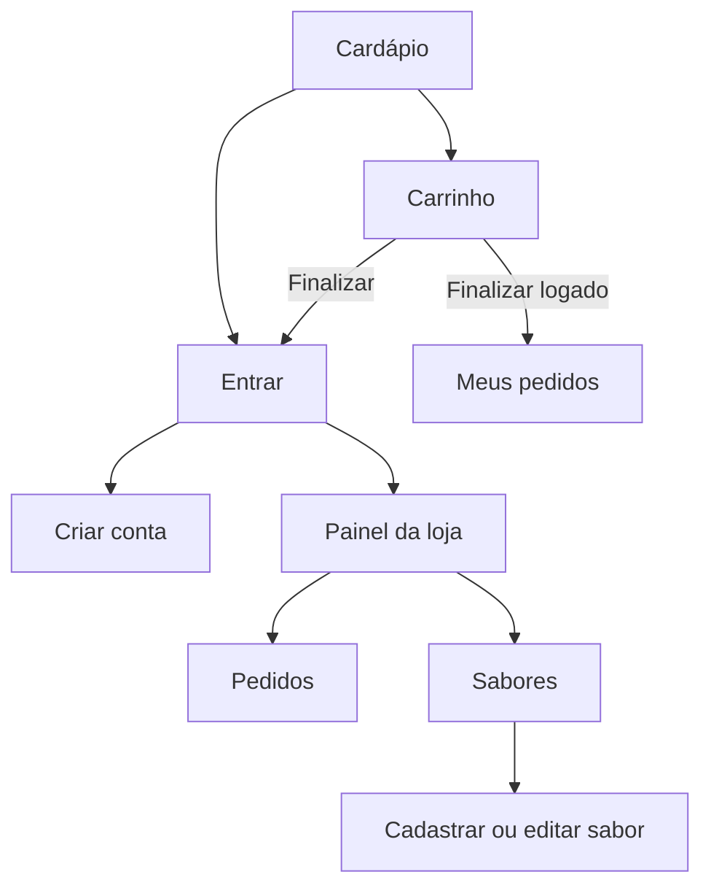

# IHC: interface humano-computador

## Princípios aplicados (material teórico)
| Princípio | Aplicação no app |
|---|---|
| Clara | Rótulos diretos ("Adicionar ao carrinho", "Finalizar pedido") |
| Consistente | Mesmo botão, cores e posição em todas as telas |
| Simples | Quatro telas principais para o cliente |
| Controlada pelo usuário | O pedido só é criado quando o cliente toca em "Finalizar pedido" |
| Reversível | Item pode ser removido do carrinho a qualquer momento |
| Com resposta | Avisos após cada ação (item adicionado, pedido recebido, erro) |
| Agradável | Paleta framboesa, pistache e cacau; cupcake ilustrado com a cor do glacê de cada sabor |

## Paleta e tipografia
Framboesa `#A3214F` (ação), Pistache `#CFE3C2` (sucesso), Cacau `#34222A` (texto), Glacê `#FFF3F6` (fundo).
Fonte Bricolage Grotesque com alternativa do sistema.

## Mapa de navegação

## Telas
| Tela | Rota | Elementos |
|---|---|---|
| Cardápio | `/` | Cards com ilustração, nome, descrição, preço e botão |
| Carrinho | `/carrinho` | Lista, remover, total, campo de endereço, finalizar |
| Entrar / Criar conta | `/login`, `/cadastro` | Formulário com rótulos e validação |
| Meus pedidos | `/pedidos` | Pedidos com itens, total e status colorido |
| Painel: pedidos | `/admin/pedidos` | Seletor de status por pedido |
| Painel: sabores | `/admin/produtos` | Lista, editar, tirar do cardápio |

## Mensagens (padrão: dizem o que houve e como resolver)
| Situação | Mensagem |
|---|---|
| E-mail ou senha errados | E-mail ou senha incorretos. Confira e tente de novo. |
| E-mail inválido | Informe um e-mail válido, como nome@exemplo.com. |
| E-mail já cadastrado | Este e-mail já tem cadastro. Entre na sua conta. |
| Carrinho vazio | Seu carrinho está vazio. Escolha um sabor para começar. |
| Endereço curto | Informe o endereço de entrega completo (rua, número e bairro). |
| Sem permissão | Esta área é exclusiva da equipe da loja. |
| Sessão expirada | A sessão expirou. Volte e envie o formulário de novo. |

> Os wireframes do Balsamiq do PIT I devem ser comparados com as telas acima e atualizados, se algo mudou.
> Salve as imagens em `situacao-1-planejamento/wireframes/`.
