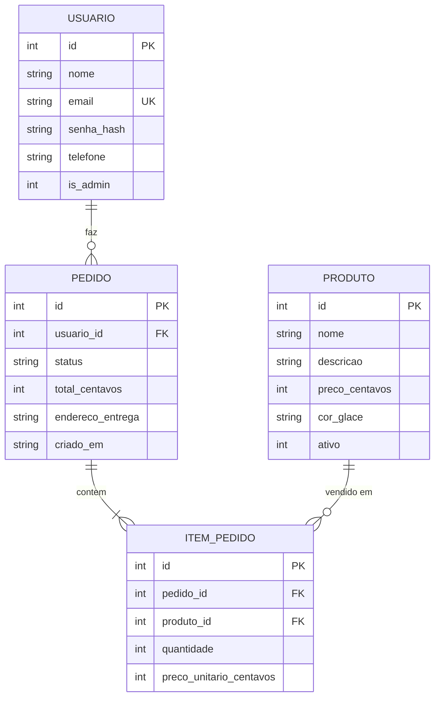

# Projeto de dados

## Modelo conceitual

## Modelo lógico normalizado
- **usuario**(<u>id</u>, nome, email, senha_hash, telefone, is_admin, criado_em)
- **produto**(<u>id</u>, nome, descricao, preco_centavos, cor_glace, ativo, criado_em)
- **pedido**(<u>id</u>, *usuario_id*, status, total_centavos, endereco_entrega, criado_em)
- **item_pedido**(<u>id</u>, *pedido_id*, *produto_id*, quantidade, preco_unitario_centavos)

**1FN:** todos os atributos são atômicos; os itens ficam em tabela própria, sem listas dentro de pedido.
**2FN:** em `item_pedido`, quantidade e preço dependem da chave inteira (pedido + produto).
**3FN:** dados do cliente e do produto não se repetem no pedido; só o preço unitário é copiado de propósito (RN01, histórico de preço).
`total_centavos` é um valor derivado guardado para consulta rápida e consistência com o preço da época.

## Projeto físico
SGBD: **SQLite 3** (popular, sem servidor, ideal para o porte do projeto). Script em [`schema.sql`](schema.sql).
Os tipos usam `INTEGER` e `TEXT`; datas em `TEXT` ISO 8601, padrão do SQLite.
Se for migrar para PostgreSQL ou MySQL, as tabelas e restrições se traduzem quase diretamente
(`AUTOINCREMENT` vira `SERIAL`/`AUTO_INCREMENT` e `datetime('now')` vira `NOW()`).

## Domínios e restrições
| Atributo | Domínio |
|---|---|
| status | Recebido, Em preparo, Pronto, Entregue, Cancelado |
| preco_centavos, preco_unitario_centavos | inteiro maior que 0 |
| quantidade | inteiro maior que 0 |
| is_admin, ativo | 0 ou 1 |
| email | único |
