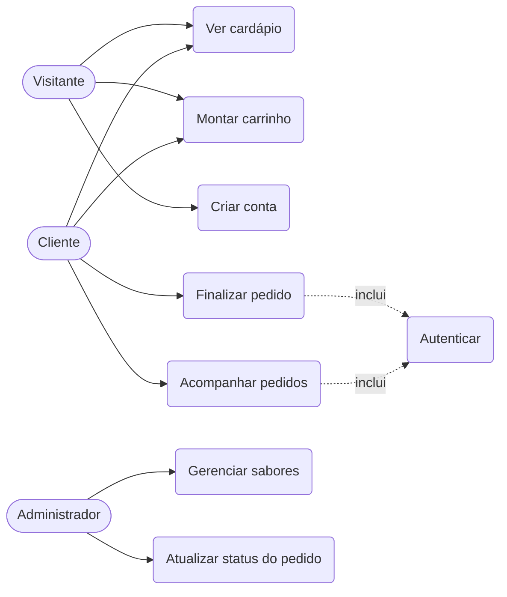
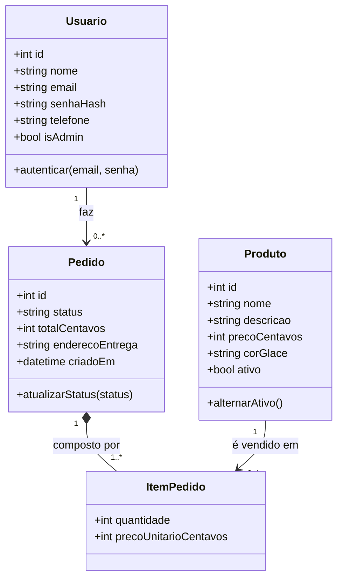
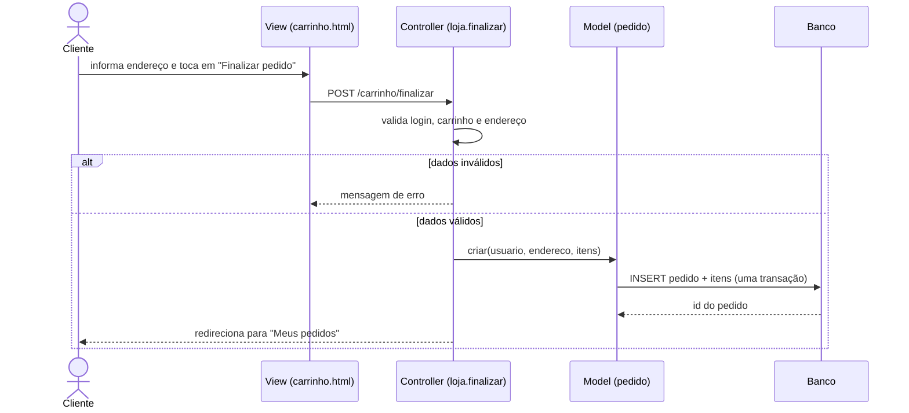
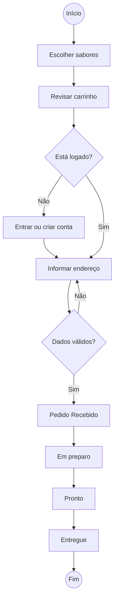
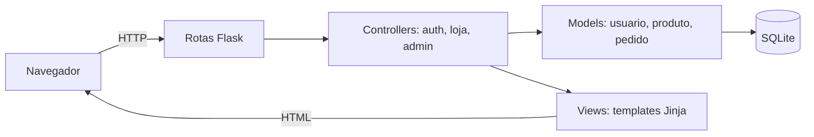

# Modelagem UML (revisada)

Os diagramas usam Mermaid, que o GitHub renderiza automaticamente. Os originais do PIT I (Draw.io/Lucidchart)
podem ser exportados e colocados na pasta `diagramas/` para comparação.

## Casos de uso

## Diagrama de classes

## Sequência: finalizar pedido

## Atividades: ciclo do pedido

## Arquitetura MVC

